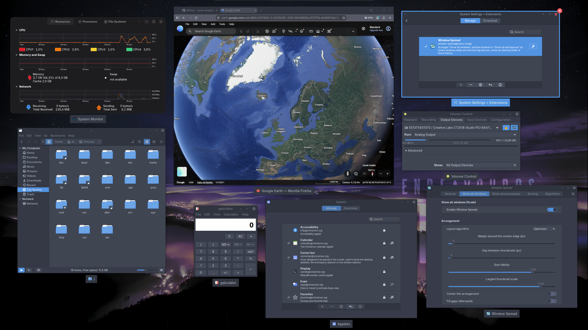

# Window Spread

A Cinnamon extension that arranges **Show all windows** (Scale), and the windows inside
each workspace in **Show all workspaces** (Expo), according to where your windows really
are and how big they are. Cinnamon's own arrangement is a grid filled in stacking order,
so windows jump around depending on which one you used last; with Window Spread they
don't. Everything else stays Cinnamon's own: how you open the views, the animations,
titles, close buttons, and clicking a window.



Works with Cinnamon 6.0 to 6.8 (Linux Mint 21.3 and later).


## Install

You only need one folder from this repository: `extension/window-spread@soren-kragh`.
Copy it into Cinnamon's extensions folder, then switch it on.

**1. Get the files**, either with git:

```
git clone https://github.com/soren-kragh/window-spread.git
cd window-spread
```

or without git: on the repository page, click **Code → Download ZIP**, then unpack it
and go into the unpacked folder (GitHub names it `window-spread-main`):

```
cd ~/Downloads
unzip window-spread-main.zip
cd window-spread-main
```

**2. Copy the extension folder** into Cinnamon's extensions folder:

```
mkdir -p ~/.local/share/cinnamon/extensions
cp -r extension/window-spread@soren-kragh ~/.local/share/cinnamon/extensions/
```

Keep the folder name exactly as it is; Cinnamon requires it to match the extension's
identifier.

**3. Switch it on:** open **System Settings → Extensions** (or run
`cinnamon-settings extensions`), select **Window Spread**, and click the **+** button at
the bottom of the list. If it isn't listed yet, restart Cinnamon (press Alt+F2, type `r`,
press Enter) and look again.

**4. Try it:** open Show all windows the way you normally do (hot corner or keyboard
shortcut). The windows now appear near where they actually are on your desktop.

**Updating** to a newer version: get the files again (`git pull` in the cloned folder,
or download a fresh ZIP), repeat step 2, and restart Cinnamon (Alt+F2, `r`).

**Removing** it: see "Switching it off or removing it" below. Nothing on your system is
changed outside that one folder, so removing it fully restores Cinnamon's own behavior.


## What's in this repository

You don't need any of this to use the extension; it's for trying out layouts and for
development.

```
window-spread/
├── README.md               this file
├── DEVELOPMENT.md          how it works, why, what's verified, open items
├── LICENSE                 MIT-0
├── extension/
│   └── window-spread@soren-kragh/   THE EXTENSION (the folder you install)
│       ├── metadata.json            name, identifier, supported Cinnamon versions
│       ├── extension.js             connects the engine to Cinnamon's views
│       ├── spreadLayout.js          the layout engine (the only copy; the lab uses it too)
│       ├── settings-schema.json     the settings window (generated)
│       ├── icon.png                 the icon (from docs/icon.svg)
│       └── LICENSE
├── lab/
│   └── window-spread-lab.html       the lab: try out and tune layouts in Firefox
├── docs/                            icon source and screenshot
├── tools/
│   ├── build-schema.js              generates settings-schema.json from the engine's defaults
│   ├── build-spices.js              builds the package for Cinnamon Spices
│   └── spices/                      Spices-specific files (info.json, README)
└── tests/                           automated checks: node tests/run-all.js
```

Tested against the source code of the latest release of every Cinnamon series from 6.0
to 6.8, and in daily use on Linux Mint 21.3 (Cinnamon 6.0.5). After a Cinnamon upgrade,
see "Checking a new Cinnamon version" in `DEVELOPMENT.md`. To change or extend the
extension, start with `DEVELOPMENT.md`.


## Settings

In **System Settings → Extensions**, select Window Spread and click its **configure**
button. The settings window offers the same knobs as the lab, on six tabs: **General**
(cache, diagnostics, restore defaults), **Show all windows** (its algorithm, margin, gap,
size fidelity and so on), **Show all workspaces** (the same for that view), **Scoring**,
**Optimizer**, and **Push-apart & rows**.

Each view's tab starts with an **Enable** switch. Switched off, Cinnamon arranges that view
itself (for Show all windows including its keyboard navigation). With both switched off,
Cinnamon behaves exactly as without the extension. Hover over a setting to see what it does.
Changes take effect the next time you open the view.

**Show all workspaces** has its own algorithm (Equal grid by default, which keeps even
small windows recognizable in the small workspace previews), margin, gap, size fidelity,
max scale, centering and gap filling. Only the scoring weights and the algorithms' own settings (Optimizer, Push-apart
& rows tabs) are shared between the two views. Settings the equal grid doesn't use are
hidden while it is selected. The equal grid puts every window in the cell nearest to
where it really is.

The tabs are short enough that the window never needs scrolling. That matters because
scrolling with the mouse wheel while the pointer is over a slider changes the slider
instead of scrolling the page (a property of Mint's settings widgets, not of this
extension).

The defaults are the values you settled on in the lab. **Restore all settings to their
defaults**, on the General tab, sets everything back to them.

Two settings are specific to the extension:

* **Reuse the previous layout when nothing has changed** (on by default): skips
  recomputing when the windows and settings are unchanged since the last time on that
  monitor and workspace. Focusing other windows, changing the stacking order, or
  minimizing and restoring windows don't count as changes.
* **Write diagnostics to the log** (off by default): see the next section.

Cinnamon never shows thumbnails larger than the real window, so the largest thumbnail
scale is limited to 1 here (the lab allows more).


## Checking that it works

Cinnamon's Looking Glass tool shows the extension's log messages:

1. In the extension's settings, switch on **Write diagnostics to the log**.
2. Open Show all windows once, preferably with at least one window minimized.
3. Press Alt+F2, type `lg`, press Enter, and open the **Log** tab. Messages from this
   extension start with `[window-spread]`.

You should see:

* `enabled`, when the extension was switched on.
* For each workspace each time the view opens (Cinnamon lays out all workspaces at
  once, so you can switch workspaces inside the view): the number of windows and how
  many are minimized, the algorithm, whether the layout was computed or reused from
  the cache, the time it took, and the score. Monitors and workspaces are identified
  by Cinnamon's internal indexes, which count from 0, plus the workspace's name as
  shown on screen, for example
  `monitor index 0, workspace index 1 ("Workspace 2")`.
* Below that, **the frame of each minimized window**. A minimized window should report
  its normal position and size, as when it is open. If it reports something like 0×0
  or a position far off screen, minimized windows would be placed oddly; tell me what
  it shows.
* Once per session: **the size of the decorations around thumbnails** (title and close
  button).
* For Show all workspaces: lines starting with `expo,`, one per monitor and workspace
  each time windows are arranged there (hovering a workspace, for example).

The extension's home is https://github.com/soren-kragh/window-spread.

If something goes wrong in the layout, the extension logs an error and falls back to
Cinnamon's original arrangement for that time, so the view keeps working. Errors also
appear in Looking Glass, and in `~/.xsession-errors`.

Switch the diagnostics off again afterwards; they aren't needed for normal use.


## Switching it off or removing it

* **Off:** in System Settings → Extensions, select Window Spread and remove it from the
  enabled extensions with the **−** button. Show all windows immediately goes back to
  Cinnamon's original arrangement; no restart is needed.
* **Remove completely:** switch it off, then delete
  `~/.local/share/cinnamon/extensions/window-spread@soren-kragh` and its saved settings in
  `~/.config/cinnamon/spices/window-spread@soren-kragh`.


## Changing the extension yourself

After changing any file in `extension/window-spread@soren-kragh`, copy the folder again
(step 2 of Install), then restart Cinnamon (Alt+F2, `r`) so it loads the new version.


## License

MIT No Attribution (MIT-0); see `LICENSE`. The extension folder carries its own copy.

## The lab

Open `lab/window-spread-lab.html` in Firefox to experiment with layouts, compare
algorithms and tune settings. The (i) buttons explain everything on the page.

The lab doesn't contain its own copy of the layout engine: it loads
`extension/window-spread@soren-kragh/spreadLayout.js`, the same file the extension uses.
What you see in the lab is therefore exactly what the extension computes. This also
means the lab only works when opened from inside this folder, with the folder
structure intact; if it can't find the engine, it says so.

The lab's simulated desktop is 1920×1080. On a real desktop, the gap between
thumbnails is a little larger than the lab shows, because Cinnamon draws a title below
each thumbnail and a close button at a corner, and the extension leaves room for them.


## Changing the defaults

All default settings are defined in one place: `DEFAULTS` near the top of
`extension/window-spread@soren-kragh/spreadLayout.js` (section 1). The lab reads them from
there. Cinnamon's settings dialog needs its own copy in `settings-schema.json`, which is
generated: after changing a default, run `node tools/build-schema.js` (needs Node.js;
on Mint: `sudo apt install nodejs`). The extension checks that the two agree when it
starts and writes a warning to the log if they don't, and `node tests/run-all.js`
reports it too.

Cinnamon keeps the values you've set in the settings window, even when defaults
change. After updating the extension with new defaults, press **Restore all settings
to their defaults** (General tab) to apply them.


## Not covered yet

* **Time budget:** the optimizer's effort is a fixed number of moves (10,000 by
  default). With the cache, the layout is only computed when something has changed;
  the log shows how long that takes on your machine.
